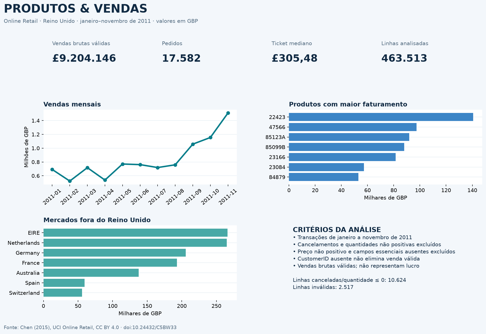

# Análise de produtos e vendas



Análise reproduzível de transações reais do conjunto [Online Retail da UCI](https://archive.ics.uci.edu/dataset/352/online+retail), atribuído a **Daqing Chen (2015)**, DOI [10.24432/C5BW33](https://doi.org/10.24432/C5BW33), licença **CC BY 4.0**. O conjunto cobre uma loja virtual britânica entre dezembro de 2010 e 9 de dezembro de 2011. O painel usa **janeiro a novembro de 2011** para evitar comparar o mês incompleto de dezembro de 2011 com meses completos.

## Perguntas respondidas

- Como evoluíram as vendas brutas válidas mês a mês?
- Quais produtos e mercados fora do Reino Unido concentraram mais receita?
- Quantos pedidos e unidades aparecem após os critérios de qualidade?
- Quantas linhas foram marcadas como cancelamento ou tinham valores inválidos?

## Método

`prepare_data.py` baixa a fonte oficial e cria uma amostra estratificada por mês para execução rápida. `analyze.py` trata datas e números com Pandas, aplica critérios explícitos de qualidade, calcula métricas de pedidos e usa **SQLite/SQL** para agrupar vendas por mês, produto e país. O painel e os CSVs em `report/full/` foram gerados a partir do conjunto completo.

Cancelamentos (número da fatura iniciado por `C`) e quantidades não positivas saem do cálculo de vendas brutas. Preço não positivo e campos essenciais ausentes também são excluídos. `CustomerID` ausente não elimina uma venda válida. **Vendas brutas não são lucro**, e nenhuma análise de devoluções líquidas foi inferida. Dezembro de 2011 foi excluído por ser parcial.

O ranking de produtos omite códigos sem dígitos, usados na fonte para itens como postagem ou ajustes manuais; esses valores continuam no total geral de vendas brutas válidas. As contagens de cancelamento e de linhas inválidas podem se sobrepor e não devem ser somadas como categorias exclusivas.

## Reproduzir

```bash
python -m venv .venv
# Ative o ambiente virtual no seu sistema
pip install -r requirements.txt
python prepare_data.py
python analyze.py --input "data/Online Retail.xlsx" --out report/full
```

Para executar rapidamente com a amostra incluída: `python analyze.py --out report/sample`. A amostra é um subconjunto real da mesma fonte, selecionado com semente fixa 42; seus totais **não** substituem os do conjunto completo.

## Arquivos principais

- `analyze.py`: limpeza, consultas SQL, indicadores e painel.
- `prepare_data.py`: download e amostragem da fonte oficial.
- `data/online_retail_sample.csv`: amostra atribuída à UCI, sob CC BY 4.0.
- `report/full/`: resultados e visualização calculados a partir do conjunto completo.

## Limites

O conjunto retrata uma loja e um período históricos. Não há custos, margens, estoque ou dados de aquisição de clientes; por isso o projeto não estima lucro nem recomenda decisões comerciais atuais.
